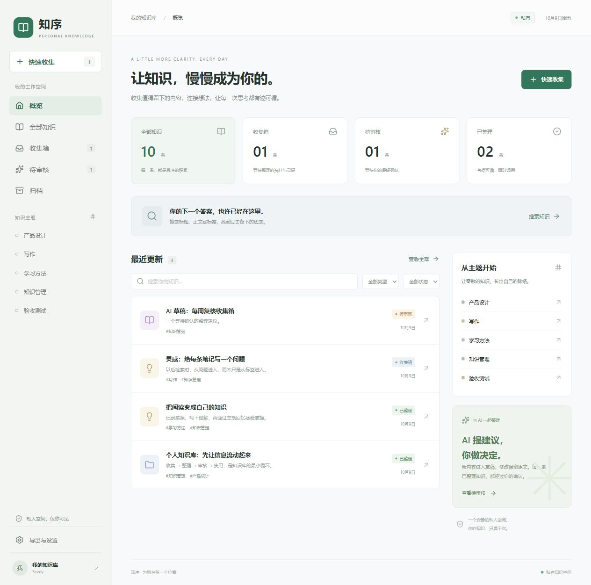
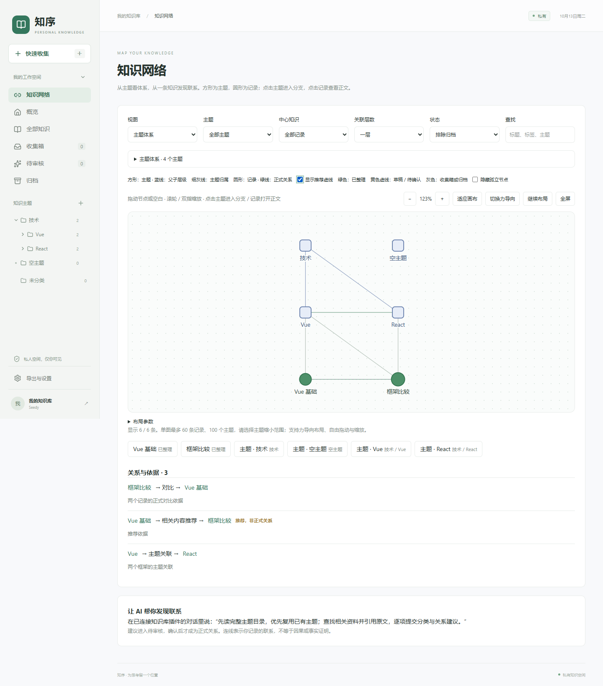
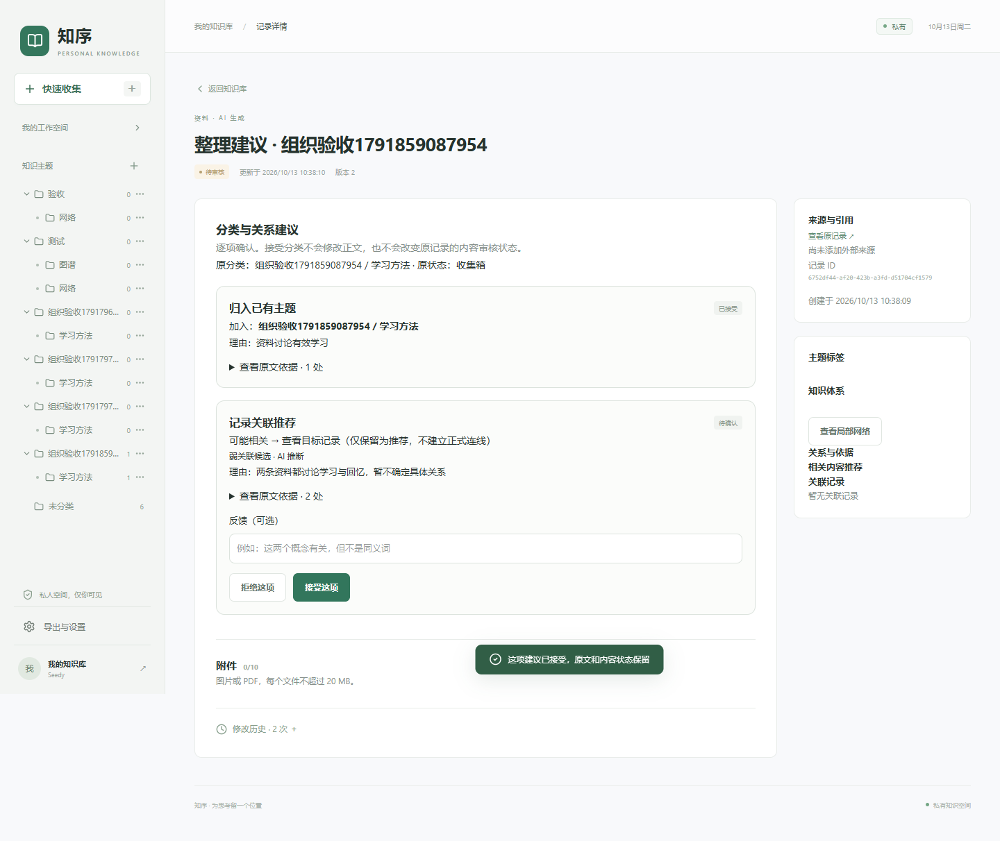
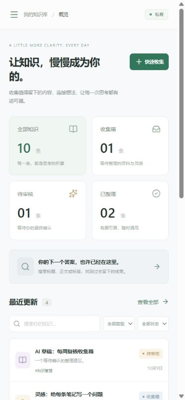
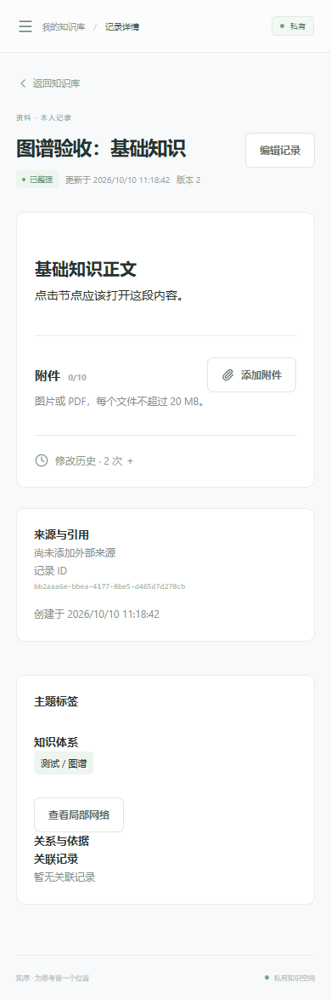

# 知序 · 个人知识库

把随手记录、网页来源和项目资料变成可以检索、追溯和复核的个人知识。

知序由 **Sites 网站**与 **Codex 技能插件**组成。每位使用者部署自己的实例，数据保存在自己的 D1 和 R2 中。仓库不提供公共知识库服务，也不连接作者的资源。

## 可以做什么

| 部分 | 作用 |
| --- | --- |
| 网站 | 随手记、中文关键词搜索、主题目录、附件、知识关系图、个人背景、修改历史与完整备份 |
| 技能插件 | 指导部署与连接；通过你已连接的个人插件检索资料、保留来源、收集草稿并提出分类和关系建议 |
| 审核流程 | AI 草稿和组织建议由你在网站逐项审核，避免把推断直接变成已确认知识 |

例如：保存一篇虚构的学习笔记，询问“我之前关于缓存失效记了什么？”，再让 AI 引用原文并提出主题关联。找不到依据时明确说明；安装技能包本身不会获得知识库访问权。

## 功能页面预览

以下截图来自本地演示与功能验收环境，使用示例或虚构资料，不包含个人知识库内容。不同版本的页面细节可能略有调整。

### 首页概览

集中查看收集箱、待审核和已整理记录，从最近更新、关键词搜索或主题入口继续整理，也可以随时快速收集新资料。



### 知识网络

用图谱展示主题层级、记录归属和知识关系。支持按主题、中心知识、关联层数与状态筛选，缩放或拖动视图，点击节点查看正文；正式关系和弱关联推荐分开展示，并保留关系依据。



### AI 分类与关系审核

AI 提出的分类和关系建议进入待审核页面。逐项查看理由与原文依据，再接受、拒绝或填写反馈；组织建议的审核不会覆盖原文或改变原记录的内容审核状态。



### 移动端阅读与收集

窄屏下可浏览概览、搜索记录和快速收集。记录详情按单栏展示正文、附件、修改历史、来源及主题关联。

<p>
  
  
</p>

## 快速开始

需要 Node.js 24 LTS、npm、Git。线上部署还需要支持 Sites 的账号与 Sites 插件。

```sh
git clone https://github.com/dmety/Personal-knowledge-base.git
cd Personal-knowledge-base
npm run install:ci
npm run build
npm run db:migrate:local
npm run dev
```

打开 `http://127.0.0.1:5173`，使用本地模拟登录。初始数据库为空；“导入虚构示例”仅在主动点击后执行。本地状态在忽略的 `.wrangler/` 中，与线上实例分离。

线上步骤见 [Sites 自部署指南](docs/部署与迁移.md)。这是动态站点，需要受信任身份认证、D1 和 R2，不能直接托管到 GitHub Pages。

## 安装 Codex 技能插件

在支持插件市场的 Codex CLI 中添加此仓库：

```sh
codex plugin marketplace add dmety/Personal-knowledge-base
```

随后在支持该市场的桌面客户端插件目录选择 **Zhixu Open Source**，安装 **Zhixu Knowledge**。市场来源可用性依客户端而异；也可克隆仓库后添加本地来源 `codex plugin marketplace add .`。

运行 `$zhixu-setup` 了解部署与连接；知识整理使用 `$knowledge-workflow`。必须另行部署自己的站点、安装该站点生成的个人插件并完成认证，技能才能调用数据工具。详见 [插件使用与配置](docs/插件使用.md)。

GitHub Release 提供技能包 ZIP。通过 GitHub 安装源分发，无需开发者身份验证。

## 验证与架构

```sh
npm run typecheck
npm test
npm run test:release
npm run plugin:pack
```

启动本地开发服务后，可执行 `node scripts/test-http.mjs`、`node scripts/test-capture-http.mjs`、`node scripts/test-profile-http.mjs`。这些测试只允许回环地址，使用虚构资料。

`app/` 提供界面、API 与 `/mcp`；`lib/` 提供数据、审核与备份业务；`drizzle/` 是仅包含表结构的迁移；`plugins/zhixu/` 是可分发技能包。

基于 Sites Vinext、React、Cloudflare D1/R2。生产身份由 Sites 提供，不能直接信任公网请求传来的身份头。第一版支持 Sites；移到其他平台需要自行实现认证与 MCP OAuth。

## 当前边界

- 关键词与别名检索；没有向量检索、自动 OCR 或 PDF 全文提取。
- AI 主要在连接后的对话中工作，站内不调用模型，不需要 `OPENAI_API_KEY`。
- 单附件 20 MB、每条记录 10 个附件；完整 ZIP 附件总量 60 MB，导入文件与解压总量 80 MB，单次导入最多 300 条记录。
- 每个部署默认仅供部署者使用；不提供多人协作服务。

MIT 开源。[隐私说明](docs/隐私说明.md) · [使用条款](docs/使用条款.md) · [问题反馈](https://github.com/dmety/Personal-knowledge-base/issues)。第三方代码保留各自许可，见 [第三方声明](THIRD_PARTY_NOTICES.md)。
